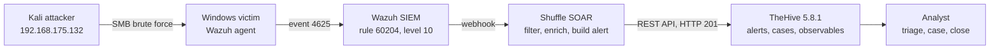
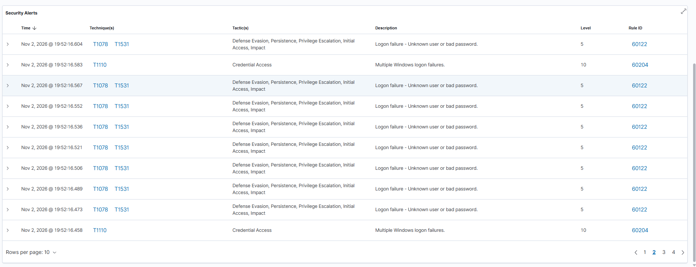
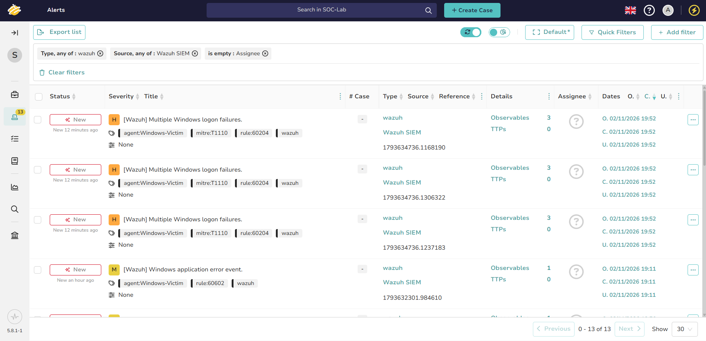
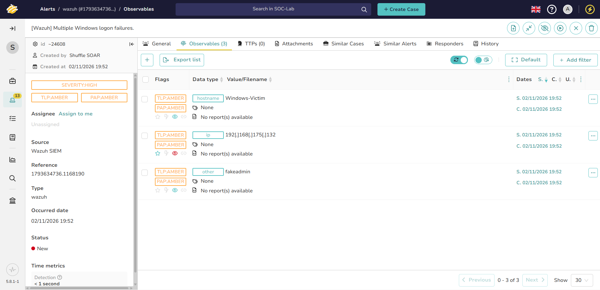
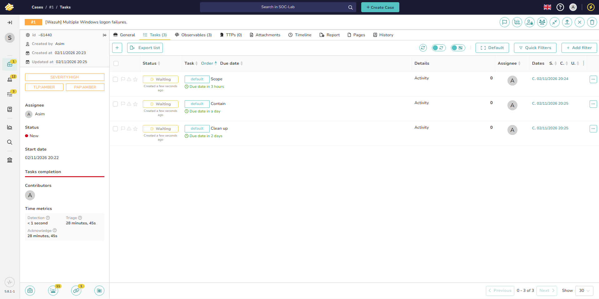
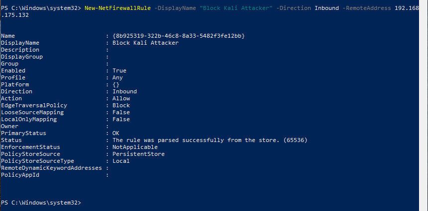
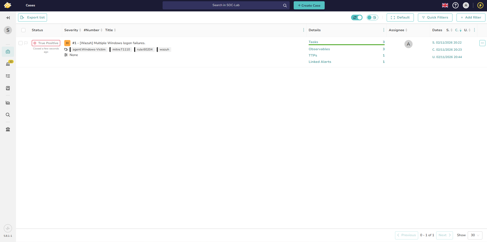

# Wazuh + Shuffle + TheHive SOC Lab

An end-to-end, open-source SOC pipeline: **Wazuh detects**, **Shuffle automates**, **TheHive tracks the investigation**. A brute-force attack from Kali becomes a High-severity TheHive alert with observables in seconds, and is worked by an analyst through to a closed, documented case.

This extends my earlier project, [Wazuh-Shuffle-SOAR-Lab](https://github.com/Asimsvictus/Wazuh-Shuffle-SOAR-Lab), by adding case management with TheHive.

📄 **Full report (PDF):** [docs/Project_Report.pdf](docs/Project_Report.pdf)

---

## Architecture



| Component | Address | Role |
| --- | --- | --- |
| Wazuh SIEM | 192.168.175.130 | Detection and correlation |
| Shuffle SOAR | self-hosted | Filtering, enrichment, routing |
| TheHive | 192.168.175.140:9000 | Case management |
| Windows victim | 192.168.175.129 | Monitored endpoint (Wazuh agent) |
| Kali | 192.168.175.132 | Attack source |

All VMs run in VMware Workstation on one NAT network.

**Why not connect Wazuh straight to TheHive?** Wazuh already feeds Shuffle. A direct link would create every alert twice and bypass Shuffle's filtering and enrichment, so everything flows SIEM → SOAR → case management.

---

## What I built

- **TheHive on its own VM** (Ubuntu Server 24.04, 8 GB RAM, 4 vCPU) using StrangeBee's Docker profile: TheHive, Cassandra and Elasticsearch.
- **Least-privilege access:** a dedicated `SOC-Lab` organisation, an analyst account for case work, and a separate **service account** whose API key is used only by Shuffle.
- **Shuffle workflow:** a start node branches to Discord and TheHive. A Python step maps Wazuh level → TheHive severity, adds tags (rule ID, MITRE technique, agent) and extracts observables (source IP, target account, host). See [`shuffle/build_thehive_alert.py`](shuffle/build_thehive_alert.py).
- **De-duplication:** each TheHive alert's source reference is the unique Wazuh alert ID, so one event never creates two alerts.

| Wazuh level | TheHive severity |
| --- | --- |
| 7 to 9 | Medium |
| 10 to 12 | High |
| 13 to 15 | Critical |

---

## Test: SMB brute force

```bash
nxc smb 192.168.175.129 -u fakeadmin -p /tmp/pw.txt
```

A non-existent account makes every attempt fail without locking out a real user.

| Hop | Result |
| --- | --- |
| Windows | Event 4625 per failed logon |
| Wazuh | Rule **60204** *Multiple Windows logon failures*, level 10, MITRE **T1110** (31 failures in the window) |
| Shuffle | Alert built and POSTed to TheHive, **HTTP 201** |
| TheHive | **High** alert with 3 observables: host, attacker IP (IOC), `fakeadmin` |





---

## Incident handling in TheHive

1. **Triage** – assigned the alert, confirmed a true positive for password guessing (T1110.001).
2. **Case** – promoted the alert to Case #1.
3. **Tasks** – Scope, Contain, Clean up, each with a task log.
4. **Scope** – no successful logon (4624) from the attacker IP.
5. **Contain** – Windows Firewall rule blocking 192.168.175.132.
6. **Close** – True Positive, no impact.





All screenshots are in [`screenshots/`](screenshots/).

---

## Problems I solved

| Problem | Fix |
| --- | --- |
| Shuffle skipped the TheHive node ("not under the startnode") | Added a dedicated start node and branched both actions from it |
| No alerts visible in TheHive | Admin org cannot hold alerts; used a service account in `SOC-Lab` |
| Invalid JSON body | Sent the Python output as the raw body, without extra braces |
| Only successful logons (60106) in early tests | Used a non-existent username so every attempt failed and triggered 60204 |
| No Shuffle execution for a live alert | Wazuh webhook pointed at a different workflow; matched the webhook IDs |
| HTTP 400 "already exists" on reruns | Expected: TheHive de-duplicates on source reference |
| StrangeBee licence portal registration failing | Built on the 14-day trial and contacted StrangeBee support |

---

## Repository layout

```
docs/Project_Report.pdf          Full write-up with all evidence
shuffle/build_thehive_alert.py   Python step that builds the TheHive alert
wazuh/ossec-integration.xml      Wazuh → Shuffle integration block
screenshots/                     Evidence for each step
```

## Next steps

- Automated response: Shuffle calls the Wazuh API to block the attacker IP, behind a human approval step
- Group repeated 60204 alerts from one burst into a single TheHive alert
- Cortex analysers for observable enrichment

---

*Lab environment only. API keys, webhook IDs and passwords are not included in this repository.*
